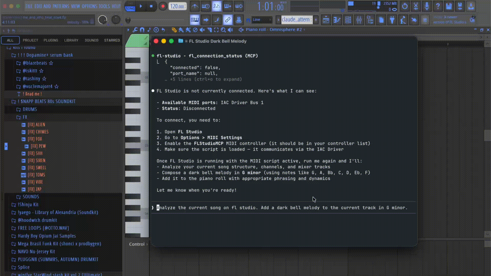

# FL Studio MCP Server

**Control FL Studio with plain language.** An MCP (Model Context Protocol) server that lets AI assistants drive FL Studio through MIDI communication and Piano Roll scripts — compose melodies, adjust mixes, and automate plugins without touching the mouse.

[](https://mcpservers.org/servers/karl-andres/fl-studio-mcp)
[](https://github.com/punkpeye/awesome-mcp-servers)
[](https://github.com/karl-andres/fl-studio-mcp/stargazers)
[](LICENSE)
[](https://www.python.org)

---

## Table of Contents

- [Demo](#demo)
- [Features](#features)
- [Limitations](#limitations)
- [Requirements](#requirements)
- [Quick Installation](#quick-installation)
- [Manual Installation](#manual-installation)
- [Which AI Clients Work With This?](#which-ai-clients-work-with-this)
- [Usage](#usage)
- [Available Tools](#available-tools)
- [Example Workflows](#example-workflows)
- [Troubleshooting](#troubleshooting)
- [Architecture](#architecture)
- [Development](#development)
- [Credits](#credits)

---

## Demo

Ask Claude to analyze your project and compose a melody — notes appear in the Piano Roll in real time:



dont mind the scuffed audio, i had to clip with my mic bc apple wouldnt let me record desktop audio lol

https://github.com/user-attachments/assets/d4fc668f-9fe5-4ab4-9f18-76cd661029c6

Hear the original audio if you'd like

https://github.com/user-attachments/assets/c2b1a5e7-1640-41fa-82bc-18ca7cbae9e8

---

## Features

### Transport Control

- Play, pause, stop playback
- Toggle recording
- Set playback position
- Get song length and position
- Control loop mode (pattern/song)
- Adjust playback speed

### Mixer Control

- Get/set track volume and pan
- Mute/solo tracks
- Arm tracks for recording
- Set track names and colors
- Stereo separation control

### Channel Rack Control

- List all channels
- Get/set channel properties (volume, pan, name, color)
- Mute/solo channels
- Route channels to mixer tracks
- Trigger MIDI notes in real-time
- Step sequencer control (get/set grid bits)

### Plugin Control

- List plugin parameters
- Get/set parameter values
- Navigate presets (next/previous)
- Query plugin info

The generic parameter editor does not open the plugin, switch focus, or send
mouse or keyboard input. It works only with parameters FL exposes.

#### Window geometry (Windows)

`fl_list_windows` reports the handle, process ID, title and physical screen
bounds of supported visible FL Studio forms. Pass these observations plus a new
top-left position to `fl_move_window`. Supply both size fields to request a
resize. The tool calls Windows directly without activating the form or sending
input. FL may clamp a docked form; check `verified_geometry` and the returned
bounds before relying on the requested position.

### Piano Roll Control

- **Add notes** to the piano roll with precise timing
- **Add chords** with a single command
- **Delete specific notes** by MIDI number and time
- **Clear all notes** from the piano roll
- **Read piano roll state** to see all existing notes
- Auto-triggering via keystroke (Cmd+Opt+Y on macOS, Ctrl+Alt+Y on Windows)

---

## Limitations

> **Cannot load plugins** — The FL Studio scripting API does not support loading new VST/AU plugins. You can only control parameters of plugins that are already loaded in your project.

> **No pattern management (yet)** — The server can write notes and step-sequencer steps into a pattern, but it has no tools to create, switch, rename, or clone patterns. Everything goes into whichever pattern is currently selected in FL Studio, so pick or create the pattern yourself before asking for notes. (FL Studio's scripting API does support this through the `patterns` module, so it could be added.)

---

## Requirements

- **FL Studio 20.7+** (MIDI Controller Scripting API)
- **Python 3.10+**
- **macOS** or **Windows**
  - macOS: IAC Driver (built-in, needs to be enabled)
  - Windows: [loopMIDI](https://www.tobias-erichsen.de/software/loopmidi.html)

---

## Quick Installation

### macOS / Linux

```bash
git clone https://github.com/karl-andres/fl-studio-mcp.git
cd fl-studio-mcp
./install.sh
```

### Windows

```powershell
git clone https://github.com/karl-andres/fl-studio-mcp.git
cd fl-studio-mcp

# Allow running local scripts for this user (one-time)
Set-ExecutionPolicy -Scope CurrentUser RemoteSigned -Force

.\install.ps1
```

`install.ps1` is the Windows counterpart to `install.sh` — same steps, PowerShell instead of bash. It installs Python 3.12 specifically (required for prebuilt `python-rtmidi` wheels on Windows).

Both installers will:

1. Install [uv](https://github.com/astral-sh/uv) if not present
2. Install Python dependencies
3. Guide you through enabling virtual MIDI ports (IAC Driver on Mac, loopMIDI on Windows)
4. Install the FL Studio MIDI controller script
5. Install the Piano Roll script (ComposeWithLLM)
6. Configure Claude Desktop or Claude Code automatically (`scripts/install_mcp_for_claude.sh` / `scripts/install_mcp_for_claude.ps1`)

> **Windows piano-roll note:** The Piano Roll script is launched by sending FL Studio a keystroke (`Ctrl+Alt+Y`). On Windows this briefly foregrounds the FL Studio window, so **FL Studio will pop to the front for a moment** each time a tool like `fl_send_notes` runs. This is expected. See [Piano Roll script not triggering](#piano-roll-script-not-triggering) if it doesn't fire at all.

---

## Manual Installation

### 1. Install Python Dependencies

```bash
# Using uv (recommended)
uv sync

# Or using pip
pip install -e .
```

### 2. Enable Virtual MIDI Ports

#### macOS (IAC Driver)

1. Open **Audio MIDI Setup** (search in Spotlight)
2. Press **Cmd+2** or go to **Window > Show MIDI Studio**
3. Double-click on **IAC Driver**
4. Check **"Device is online"**
5. Click **Apply**

#### Windows (loopMIDI)

1. Download and install [loopMIDI](https://www.tobias-erichsen.de/software/loopmidi.html)
2. Create a virtual port (any name works)
3. Keep loopMIDI running while using FL Studio

### 3. Install FL Studio Scripts

Copy the controller script to FL Studio's Hardware folder:

```bash
# macOS
mkdir -p ~/Documents/Image-Line/FL\ Studio/Settings/Hardware/FLStudioMCP
cp fl_controller/device_FLStudioMCP.py ~/Documents/Image-Line/FL\ Studio/Settings/Hardware/FLStudioMCP/

# Windows
mkdir "%USERPROFILE%\Documents\Image-Line\FL Studio\Settings\Hardware\FLStudioMCP"
copy fl_controller\device_FLStudioMCP.py "%USERPROFILE%\Documents\Image-Line\FL Studio\Settings\Hardware\FLStudioMCP\"
```

Copy the Piano Roll script:

```bash
# macOS
cp scripts/ComposeWithLLM.pyscript ~/Documents/Image-Line/FL\ Studio/Settings/Piano\ roll\ scripts/

# Windows
copy scripts\ComposeWithLLM.pyscript "%USERPROFILE%\Documents\Image-Line\FL Studio\Settings\Piano roll scripts\"
```

### 4. Configure FL Studio

1. **Restart FL Studio** (if it's running)
2. Go to **Options > MIDI Settings**
3. Under **Input**, find your virtual MIDI port (e.g., "IAC Driver Bus 1")
4. Set the **Controller type** to **FLStudioMCP**
5. Enable the port (click to highlight it)

### 5. Configure Your MCP Client

Add to your Claude Desktop config:

- macOS: `~/Library/Application Support/Claude/claude_desktop_config.json`
- Windows: `%APPDATA%\Claude\claude_desktop_config.json`

```json
{
  "mcpServers": {
    "fl-studio": {
      "command": "uv",
      "args": ["run", "--directory", "/path/to/fl-studio-mcp", "fl-studio-mcp"]
    }
  }
}
```

For Claude Code, add to your MCP settings (`~/.claude.json`, or run `claude mcp add`).

---

## Which AI Clients Work With This?

This is a standard [MCP](https://modelcontextprotocol.io) server that talks to clients over stdio — it isn't hardcoded to any one AI vendor. In principle, **any MCP-compatible client can connect**: Claude Desktop, Claude Code, Cursor, Windsurf, Gemini CLI, OpenAI's Codex CLI/Agents SDK, etc.

**What's actually tested and auto-configured:** only **Claude Desktop** and **Claude Code**, via `scripts/install_mcp_for_claude.sh` (macOS/Linux) and `scripts/install_mcp_for_claude.ps1` (Windows). Other clients have no installer support — you'd need to manually add the following MCP server entry to that client's own config:

```json
{
  "command": "uv",
  "args": ["run", "--directory", "/path/to/fl-studio-mcp", "fl-studio-mcp"]
}
```

Replace `/path/to/fl-studio-mcp` with your local clone path. If you try this with a non-Claude client, please open an issue with what worked or didn't — the protocol should support it, but it hasn't been verified here.

---

## Usage

### Running the Server Manually

```bash
# Using uv
uv run fl-studio-mcp

# Or after installation
fl-studio-mcp
```

### Piano Roll Workflow

1. Open FL Studio and select a channel
2. Open the Piano Roll (F7 or double-click the channel)
3. The first time, manually run the script: **Tools > Scripting > ComposeWithLLM**
4. After that, the MCP tools will auto-trigger the script

---

## Available Tools

### Connection

| Tool | Description |
|------|-------------|
| `fl_connect` | Connect/reconnect to FL Studio |
| `fl_connection_status` | Get connection status |

### Transport

| Tool | Description |
|------|-------------|
| `fl_play` | Start/pause playback |
| `fl_stop` | Stop playback |
| `fl_record` | Toggle recording |
| `fl_get_transport_status` | Get playback/recording state |
| `fl_set_song_position` | Set playback position |
| `fl_get_song_length` | Get song duration |
| `fl_set_loop_mode` | Switch between pattern/song mode |
| `fl_set_playback_speed` | Adjust playback speed (0.25x–4x) |

### Mixer

| Tool | Description |
|------|-------------|
| `fl_get_mixer_track_count` | Get number of mixer tracks |
| `fl_get_mixer_track_info` | Get track details |
| `fl_get_all_mixer_tracks` | List all tracks |
| `fl_set_track_volume` | Set track volume |
| `fl_set_track_pan` | Set track pan |
| `fl_mute_track` | Mute/unmute track |
| `fl_solo_track` | Solo/unsolo track |
| `fl_arm_track` | Arm track for recording |
| `fl_set_track_name` | Rename track |
| `fl_set_track_color` | Set track color |
| `fl_set_stereo_separation` | Adjust stereo width |

### Channels

| Tool | Description |
|------|-------------|
| `fl_get_channel_count` | Get number of channels |
| `fl_get_channel_info` | Get channel details |
| `fl_get_all_channels` | List all channels |
| `fl_get_selected_channel` | Get selected channel |
| `fl_select_channel` | Select/deselect channel |
| `fl_select_one_channel` | Select channel exclusively |
| `fl_trigger_note` | Trigger MIDI note (real-time) |
| `fl_set_channel_volume` | Set channel volume |
| `fl_set_channel_pan` | Set channel pan |
| `fl_mute_channel` | Mute/unmute channel |
| `fl_solo_channel` | Solo/unsolo channel |
| `fl_set_channel_name` | Rename channel |
| `fl_set_channel_color` | Set channel color |
| `fl_route_channel_to_mixer` | Route to mixer track |
| `fl_get_grid_bit` | Get step sequencer step |
| `fl_set_grid_bit` | Set step sequencer step |
| `fl_get_step_sequence` | Get full pattern |
| `fl_set_step_sequence` | Set full pattern |

### Plugins

| Tool | Description |
|------|-------------|
| `fl_is_plugin_valid` | Check if plugin exists |
| `fl_get_plugin_name` | Get plugin name |
| `fl_get_plugin_param_count` | Get parameter count |
| `fl_get_plugin_params` | List all parameters |
| `fl_list_plugin_instances` | Find loaded Channel Rack instruments and Mixer effects |
| `fl_describe_plugin` | Search a plugin's parameters and read their values |
| `fl_edit_plugin` | Edit parameters by name or index with readback |
| `fl_get_plugin_param_value` | Get parameter value |
| `fl_set_plugin_param_value` | Set parameter value |
| `fl_get_preset_count` | Get preset count |
| `fl_next_preset` | Next preset |
| `fl_prev_preset` | Previous preset |
| `fl_get_plugin_color` | Get plugin color |

### Piano Roll

| Tool | Description |
|------|-------------|
| `fl_send_notes` | Add notes to the piano roll |
| `fl_send_chord` | Add a chord (multiple notes at same time) |
| `fl_delete_notes` | Delete specific notes |
| `fl_clear_piano_roll` | Clear all notes |
| `fl_get_piano_roll_state` | Read current piano roll notes |
| `fl_trigger_script` | Manually trigger the FL Studio script |
| `fl_get_piano_roll_info` | Get piano roll system info |
| `fl_clear_request_queue` | Cancel pending queued changes |

---

## Example Workflows

### Checking a WAV Render

Pass a completed local WAV to `fl_verify_audio_output(audio_path, expected_duration)`.
`expected_duration` is optional and measured in seconds; the comparison allows
one sample frame of rounding. The tool reports peak, RMS and DC offset per
channel, and counts full-scale and nonfinite samples. A silent file or an
incomplete scan cannot pass. If `max_frames` truncates the scan, the metrics
describe only the scanned prefix. The tool also caps each scan at 50 million
samples across all channels.

The check reads PCM and IEEE float RIFF/WAVE files, with no FL connection or
project writes. It checks the file and its signal, not the quality of the mix.

### Adjusting a Mix

```text
"Set the volume of mixer track 1 to 80% and pan it slightly left"
```

### Creating a Drum Pattern

```text
"Create a basic kick pattern on channel 0 with kicks on steps 0, 4, 8, and 12"
```

### Adding a Melody to Piano Roll

```text
"Add a C major arpeggio starting at beat 0: C4, E4, G4, C5 - each note quarter duration"
```

### Adding Chords

```text
"Add a C major chord at beat 0, then F major at beat 2, then G major at beat 4"
```

### Automating Plugin Parameters

```text
"List the parameters of the plugin on channel 0 and set the filter cutoff to 50%"
```

For any loaded instrument or effect, use `fl_list_plugin_instances` to find its
target. `channel:13` is global Channel Rack index 13 and `mixer:23:0` is the first
effect slot on mixer track 23. `fl_describe_plugin` lists matching parameter
names, indices, and values. Set `include_text` to read labels supplied by the plugin
and follow `next_start` for more results.

Pass the returned fingerprint to `fl_edit_plugin`, along with edits such as
`{"parameter": "Mix", "value": 0.3}`. Use an index for duplicate names and
`dry_run: true` to preview. Values use FL's normalized 0–1 range. Optional
`expected_name` and `expected_value` fields guard the observed parameter state.
The fingerprint checks the location, plugin name and parameter count.

The edit reports values read back from FL. A partial failure can leave earlier
changes applied. Some plugins round or reject values. Private controls that
the plugin does not expose to FL are outside this tool's scope. The tool does
not fall back to clicking the plugin editor or changing its preset.
Install and reload the updated controller script to enable these tools.

---

## Troubleshooting

### "Not connected to FL Studio"

1. Ensure FL Studio is running
2. Check that the FLStudioMCP controller is enabled in MIDI Settings
3. On Mac, verify IAC Driver is enabled in Audio MIDI Setup
4. On Windows, verify loopMIDI is running
5. Restart FL Studio after enabling the controller

### "Timeout waiting for FL Studio response"

1. Make sure FL Studio is in focus
2. Check the Script output window in FL Studio (**View > Script output**)
3. Verify the controller is receiving MIDI (look for activity in MIDI Settings)

### Piano Roll script not triggering

1. First time: manually run **Tools > Scripting > ComposeWithLLM** in FL Studio
2. On macOS: grant Accessibility permissions when prompted
3. On Windows: the MCP server foregrounds the FL Studio window automatically before sending the hotkey — if FL Studio isn't running or is minimized to the system tray, the trigger can't find it and will fall back to a warning telling you to press the hotkey manually
4. Try pressing Cmd+Opt+Y (macOS) or Ctrl+Alt+Y (Windows) manually to confirm the hotkey is bound to the script in FL Studio
5. If you just updated the server code (e.g. pulled a fix), **fully restart** your MCP client (Claude Desktop/Code) — reconnecting the MCP server alone does not respawn the underlying process

### No MIDI ports available

- **macOS**: Enable IAC Driver in Audio MIDI Setup
- **Windows**: Install and run loopMIDI

---

## Architecture

This MCP server uses a hybrid approach:

```
┌─────────────────┐     ┌─────────────────────────────────────────┐
│   MCP Client    │────▶│           FastMCP Server                │
│  (Claude, etc)  │     │                                         │
└─────────────────┘     │  ┌─────────────────┐  ┌──────────────┐  │
                        │  │ MIDI + JSON     │  │ Piano Roll   │  │
                        │  │ Tools           │  │ Tools (JSON) │  │
                        │  └────────┬────────┘  └──────┬───────┘  │
                        └───────────┼──────────────────┼──────────┘
                                    │                  │
                               MIDI + JSON        JSON Files +
                                    │              Keystroke
                                    ▼                  ▼
                        ┌─────────────────────────────────────────┐
                        │              FL Studio                   │
                        │  ┌──────────────┐  ┌──────────────────┐ │
                        │  │FLStudioMCP   │  │ Piano Roll Script│ │
                        │  │(MIDI Ctrl)   │  │ (ComposeWithLLM) │ │
                        │  └──────────────┘  └──────────────────┘ │
                        └─────────────────────────────────────────┘
```

### How It Works

**Transport / Mixer / Channels / Plugins:**
1. MCP server writes command to JSON file
2. Sends MIDI trigger note to FL Studio
3. FL Studio controller script reads JSON, executes API, writes response
4. MCP server reads response

**Piano Roll:**
1. MCP server writes note requests to JSON file
2. Sends keystroke (Cmd+Opt+Y on macOS, Ctrl+Alt+Y on Windows) to trigger FL Studio script — on Windows, the FL Studio window is foregrounded first so the keystroke actually reaches it
3. Piano Roll script reads JSON and modifies notes

---

## Development

### Prerequisites

- Python 3.10+
- [uv](https://github.com/astral-sh/uv) (recommended)

### Setup

```bash
# Install all dependencies including dev extras
uv sync --dev

# Or with pip
pip install -e ".[dev]"
```

### Available Commands

| Command | Description |
|---------|-------------|
| `uv run fl-studio-mcp` | Run the MCP server |
| `uv run ruff check .` | Lint the codebase |
| `uv run ruff check --fix .` | Lint and auto-fix |
| `uv run pytest` | Run tests |

### Project Structure

```
fl-studio-mcp/
├── fl_controller/
│   └── device_FLStudioMCP.py     # FL Studio MIDI controller script (runs inside FL Studio)
├── scripts/
│   ├── setup.sh                  # FL Studio script installer
│   ├── install_mcp_for_claude.sh # Claude config installer (macOS/Linux)
│   ├── install_mcp_for_claude.ps1# Claude config installer (Windows)
│   └── ComposeWithLLM.pyscript   # Piano Roll script (runs inside FL Studio)
├── src/fl_studio_mcp/
│   ├── server.py                 # FastMCP server entry point
│   ├── tools/                    # MCP tool implementations
│   │   ├── channels.py
│   │   ├── mixer.py
│   │   ├── piano_roll.py
│   │   ├── plugins.py
│   │   └── transport.py
│   └── utils/
│       ├── connection.py         # FL Studio connection wrapper
│       ├── fl_trigger.py         # Piano roll keystroke trigger
│       └── midi_connection.py    # MIDI + JSON communication layer
├── install.sh                    # One-command installer (macOS/Linux)
└── install.ps1                   # One-command installer (Windows)
```

---

## Credits

- [FL Studio API Stubs](https://github.com/IL-Group/FL-Studio-API-Stubs) — API documentation
- [FastMCP](https://github.com/jlowin/fastmcp) — MCP server framework
- [mido](https://github.com/mido/mido) — MIDI library for Python
- [calvinw/fl-studio-mcp](https://github.com/calvinw/fl-studio-mcp) — Piano Roll integration approach
- [Image-Line](https://www.image-line.com/) — FL Studio

## Contributing

Contributions are welcome! Feel free to open an issue or a pull request.

Just a heads-up: this project doesn't have a proper test suite, CI, or review process for PRs yet. I'm a student maintaining this in my spare time, so changes are mostly tested by hand in FL Studio. If you'd like to help set up testing or a smoother contribution workflow, that help is especially welcome.

## License

MIT
